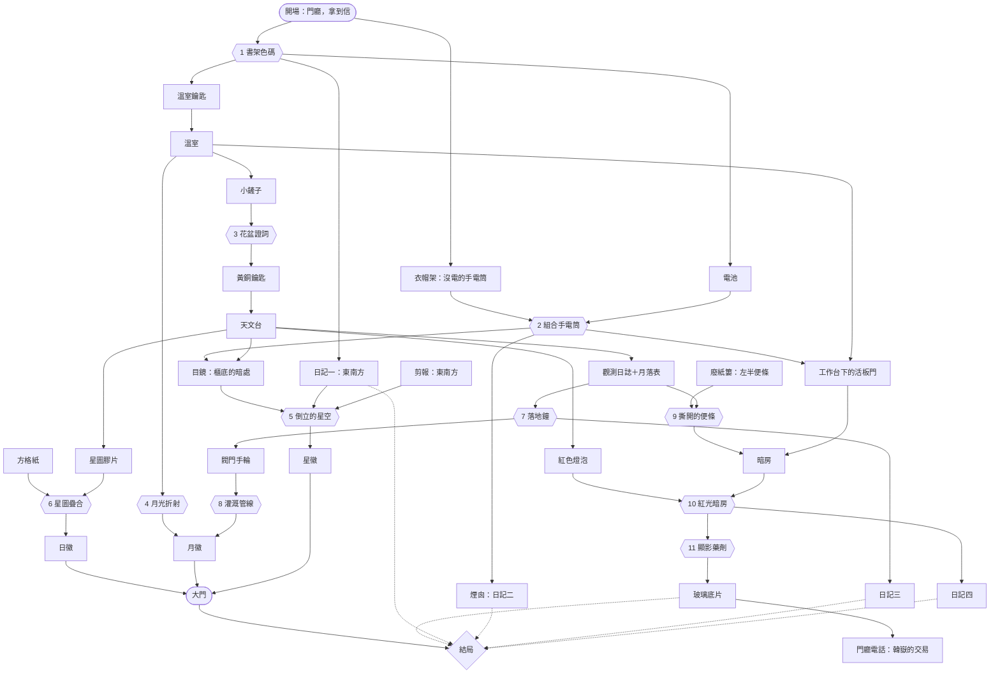
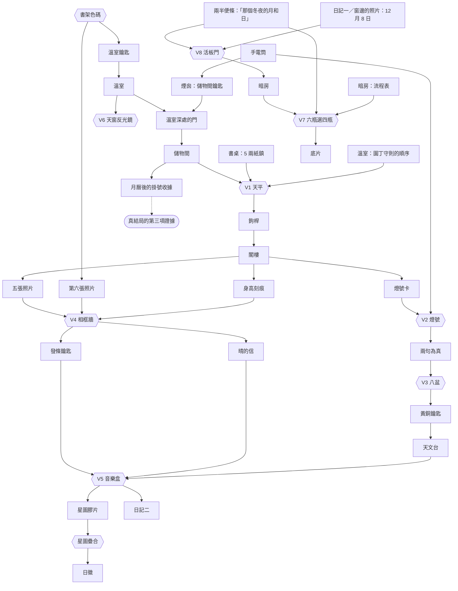

# 《觀星者之屋》遊戲設計文件

> **劇透警告**：本文件列出所有謎題的完整解法。想自己玩的話，請先別往下看。

本文件是「遊戲設計師」角色的產出：故事、空間、謎題鏈、結局條件，以及支撐「公平、無死局」的設計原則。所有數值與文字的唯一來源是 [`js/data.js`](../js/data.js)；本文件描述其設計意圖，測試（[`tests/`](../tests)）負責證明兩者一致。

---

## 1. 一句話

雨後的山中老宅，亡師陸觀用機關鎖住了大門。找回日、月、星三枚徽章就能離開；但屋裡還藏著二十年前一顆彗星的真相——帶不帶走它、怎麼處理它，決定你看到哪一個結局。

遊戲有兩種難度：**新手**（第 1～10 節）與 **資深**（第 11 節：多兩個房間、兩位角色、四道新謎題，三道舊謎題升級，答錯只說「不對」）。

## 2. 故事

| 人物 | 身分 |
| --- | --- |
| 沈遙（阿遙，玩家） | 陸觀的學徒，收到老師死後寄來的信。 |
| 陸觀 | 業餘天文學家，三週前病逝。1999 年 12 月 8 日拍下一顆新彗星。 |
| 韓嶽 | 陸觀的老師輩，借走陸觀的紀錄後，於 12 月 11 日以自己的名義發表「韓嶽彗星」。 |

**真相鏈**（玩家從遊戲內文件拼湊）：

1. 剪報（1999/12/11）：韓嶽宣稱 12 月 10 日在**東南方**發現彗星，公布的坐標是「赤緯 −17 度」；剪報上的「十日」被陸觀用紅筆畫了問號。
2. 日記一（12/8）：陸觀在**東南方**看見彗星，拍了三張玻璃底片。
3. 日記二（12/9）：韓嶽借走紀錄和兩張已沖洗的底片；第三張沒沖，藏進暗房的避光盒。
4. 日記三（12/12）：那晚陸觀把赤緯 −16 誤寫成 −17、當場劃掉改正；韓嶽發表的坐標連這個劃掉的「7」都照抄了。
5. 日記四（臨終前）：彗星在群星間每晚移動，底片上的相對位置就是日期，無法偽造；底片紙套背面也記著同一個劃掉的「7」。
6. 暗房：沖洗出 1999.12.08 的第三張底片，紙套背面是陸觀的筆跡「赤緯 −1~~7~~6°」。玩家可以親眼對照剪報上的 −17。

真結局的說服力來自**兩項獨立證據**（底片的日期 + 照抄的錯誤），所以只有底片、日記不全時，結局是「孤證」——這是刻意的設計，讓「探索得多徹底」有敘事上的意義，而不只是收集率。

## 3. 空間

```
                 ┌──────────┐
                 │  天文台  │
                 └────┬─────┘
                      │ 樓梯鐵門（黃銅掛鎖）
 ┌──────┐   ┌─────────┴─────────┐   ┌──────┐  活板門（4 位數）  ┌──────┐
 │ 書房 ├───┤       門廳        ├───┤ 溫室 ├───────────────────┤ 暗房 │
 └──────┘   │ 大門：日／月／星槽 │   └──────┘  （工作台底下）    └──────┘
            └───────────────────┘
            溫室門：葉形鑰匙孔
```

五個房間、以門廳為樞紐。已解鎖的房間可以隨時快速往返，避免無意義的走路。每個房間的謎題都依賴其他房間的東西（見第 5 節），玩家必須在房間之間來回推理。

## 4. 謎題一覽

主線（拿到三枚徽章、走到普通結局）必經 **8 道謎題**；支線（真相）再加 **3 道**，共 11 道，類型各不相同。

| # | 謎題 | 地點 | 類型 | 線索（全部在屋內） | 解答 | 獎勵 |
| --- | --- | --- | --- | --- | --- | --- |
| 1 | 書架色碼 | 書房 | 觀察與對應 | 抽屜鎖便條「紅、黃、藍、綠——各是第幾卷？」＋書架上未按順序排列的九卷書 | **3751**（紅 3、黃 7、藍 5、綠 1） | 溫室鑰匙、電池、日記一 |
| 2 | 暗處之光 | 門廳＋書房 | 物品組合 | 大衣口袋的沒電手電筒＋抽屜裡的電池；屋內多處「太暗看不清」 | 組合兩者 | 手電筒 |
| 3 | 花盆證詞 | 溫室 | 純邏輯（真假話） | 木牌：只有一盆埋著東西、四句話只有一句為真 | **玫瑰盆** | 黃銅鑰匙（開樓梯鐵門） |
| 4 | 月光折射 | 溫室 | 空間操作 | 守則：月光花只在月光照到時開花；光路即時顯示 | A、D、G 設「\」，B、C、E、F 設「/」 | 月光照到月光花 |
| 5 | 倒立的星空 | 天文台 | 多線索推理＋圖形辨識 | 剪報與日記一的「東南」、穹頂轉輪、目鏡（要用手電筒從櫃底找回）、「成像上下顛倒」便條、星座圖的星數、星盤刻字「以真實天空為準」 | 外環**鑰**、中環**舟**、內環**鳥** | 星徽 |
| 6 | 星圖疊合 | 書房＋天文台 | 線索組合 | 書桌的數字方格紙＋地圖櫃的星圖膠片（四角都有十字）＋畫框背面「星星會告訴你數字」 | **472** | 日徽 |
| 7 | 最後的觀測 | 門廳＋天文台 | 跨文件推算 | 鐘上刻字（最後一次觀測開始的那一刻）＋觀測日誌（10/3，月落後整整一小時開始）＋月落表（10/3 月落 02:15） | **3 點 15 分** | 閥門手輪、日記三 |
| 8 | 灌溉管線 | 溫室 | 約束滿足 | 園丁守則（月光花只要雨水、蕨類兩種都要、仙人掌一滴不給）＋管線圖 | 開 **V2、V4、V5**，關 V1、V3 | 月光花喝到雨水（與 #4 一起讓月光花開花 → 月徽） |
| 9 | 撕開的便條 | 書房＋天文台＋溫室 | 線索組合 | 廢紙簍裡的左半＋觀測日誌裡夾著的右半；工作台底下要用手電筒照 | **1208** | 進入暗房 |
| 10 | 紅光暗房 | 天文台→暗房 | 物品推理 | 活板門內側「只准開紅燈，白光會毀掉一切」＋天文台的紅光檯燈 | 紅色燈泡裝進燈座 | 點亮暗房 |
| 11 | 顯影藥劑 | 暗房 | 邏輯格＋排序 | 藥瓶卡片四條規則（推出每瓶內容）＋便條上的沖洗順序 | 黃 → 白 → 藍 → 紅 | 玻璃底片 |
| — | 煙囪（選擇性） | 書房 | 工具探索 | 壁爐「太黑看不清」 | 對壁爐用手電筒 | 日記二 |

每道謎題的唯一解由 [`tests/puzzles.test.js`](../tests/puzzles.test.js) 窮舉證明（例如閥門 32 種組合只有 1 種、鏡子 128 種只有 1 種、藥瓶 24 種排列只有 1 種、花盆 4 種假設只有 1 種）。

### 4.1 推理細節與刻意設下的「陷阱」

- **書架色碼**：書在架上的位置與卷數不同。數位置的人會輸入 7135——遊戲會溫和提醒「便條問的是第幾卷」。
- **花盆證詞**：鑰匙在玫瑰盆時，只有薰衣草盆「鑰匙不在我這裡」為真；其他三種假設都有兩句以上為真。
- **倒立的星空**：目鏡裡由上而下是 鳥（4 星）、舟（5 星）、鑰（6 星），但成像是倒的，真實天空由高到低是 鑰、舟、鳥。目鏡上方看得到倒掛的山稜與樹影，讓倒像與「誰最靠近地平線」在畫面上就看得出來；星盤的三環明確標示按「天空中的高低」對應（外環最高、內環最低），避免玩家以「離視野中心的遠近」去對應。八個星座星數各不相同（3～10），所以即使圖形倒轉也能靠數星辨認。若玩家選對了三個星座但順序錯，星盤會回應「三個星座似乎沒錯，但順序不對」。
- **最後的觀測**：直接輸入月落時刻 2:15 不會開；要記得日誌說「月落後整整一小時」。
- **灌溉管線**：答錯時會逐格描述哪個植物出了問題，玩家可以據此修正推理。
- **撕開的便條**：密碼「12｜08」與順序「顯影→停｜影」都正好橫跨撕口，單看任一半都讀不出來（測試會檢查）。
- **顯影藥劑**：卡片第四條＋第一條 → 清水在紅蓋；第二條 → 定影在藍或黃；第三條 → 只剩「藍＝定影、黃＝顯影、白＝停影」可行。答錯時用廢片試沖，不會毀掉真正的底片。

## 5. 依賴關係



設計上的交錯：書房的抽屜開溫室；溫室的花盆開天文台；天文台的日誌解門廳的鐘；鐘裡的手輪回到溫室；天文台的膠片回到書房的保險箱；書房的手電筒回到天文台找目鏡；書房的剪報與日記告訴天文台該看哪個方位。

## 6. 結局

在三枚徽章歸位後點擊大門，或在帶著底片回到門廳、接起響起的電話時做出選擇：

| 結局 | 等級 | 條件 |
| --- | --- | --- |
| 「陸觀彗星」 | 真結局 | 帶著底片＋四頁日記全部到手 → 選擇公開真相 |
| 「孤證」 | 未竟結局 | 帶著底片、日記不滿四頁 → 選擇公開真相 |
| 「沉睡的星」 | 抉擇結局 | 帶著底片 → 選擇把它留在屋裡 |
| 「破曉」 | 普通結局 | 沒有底片 → 離開 |
| 「交易」 | 壞結局 | 帶著底片時接起韓嶽的電話 → 接受交易 |

- 韓嶽之所以知道底片被找到，是因為暗房的紅燈從氣窗翹起的黑布透了出去（暗房場景可以看到）。
- 每個結局前都有一步確認；遊戲在做出選擇前自動建立「結局前存檔」，結局畫面可以一鍵回去改選。
- 已看過的結局記錄在「結局圖鑑」。

## 7. 設計原則

1. **公平**：開場的信就承諾「答案都在屋子裡」（資深模式的信改為「答案幾乎都在屋子裡，唯獨有一個答案得去問周伯」，因為八個花盆非問他不可）。所有謎題只需要遊戲內資訊；關鍵事實盡量有兩個獨立來源（「東南」同時出現在剪報與日記一）。不需要任何天文、化學或外語知識——倒像、星座、藥劑用途全部在遊戲內說明。
2. **沒有死局**：鑰匙、燈泡、手輪等只會在唯一正確的地方被用掉；答錯沒有懲罰；不存在「用錯就毀掉」的物品（暗房拒絕開白光、顯影先用廢片試）。唯一不可逆的行為是結局本身，而且都有確認步驟與結局前存檔。這一點由狀態空間窮舉證明（見測試報告）。**例外**：資深模式的八盆挖錯三盆就失敗，這是使用者要求的刻意設計，見 11.8。
3. **非線性**：主線上同時有多條可以推進的線，卡在一題時通常還有別的事可做。
4. **錯誤回饋要有資訊量**：常見錯誤（數位置、忘記倒像、忘了加一小時、閥門哪格出問題）都有針對性的回應，但不直接給答案。
5. **三段式提示、不劇透**：方向 → 線索在哪 → 答案。每個提示只在玩家看過相關物件之後才出現，標題不提獎勵；還沒發現的東西，只會由「還沒仔細看過的地方」逐步指引。使用次數會在結算畫面顯示。**每一段都要先確認**（應使用者要求）：按下提示按鈕後先出現確認框，確定了才顯示。如果下一段會直接公布答案，確認框改成閃動的紅色，寫明「這一段會直接公布答案」，焦點預設停在「先不用」，避免連按 Enter 就看到答案。哪一段是答案由資料明確標記（預設是最後一段；「陸觀的日記」在第二段就列出所有頁面的位置），測試會檢查答案不會提早出現在前面的段落。
6. **可及性**：全部可用鍵盤操作；場景物件也以按鈕列出；彩色線索附文字標籤（書脊色名、閥門開／關）；沒有時間限制；尊重「減少動態效果」設定；`<html lang>` 隨語言切換，螢幕閱讀器會用對的語言朗讀。
7. **拿到線索才能作答**（應使用者要求，兩種難度都適用）：重玩的人不能直接輸入背下來的答案。還沒拿到某道謎題的線索時，那道謎題**不論輸入什麼**都只得到同一句「你還不知道……」——不會因為輸入的剛好是正確答案而有不同的回應（否則等於洩漏答案），不算錯誤、不扣花盆的機會、不改變任何狀態。線索本身就畫在謎題上的（新手花盆、鏡子、閥門、相框）不設門檻。

   | 謎題 | 要先拿到的線索 |
   | --- | --- |
   | 書桌抽屜 | 看過書架 |
   | 保險箱 | 疊好的星圖（方格紙＋星圖膠片） |
   | 活板門 | 拼好的便條（或兩半都在手上） |
   | 落地鐘 | 讀過觀測日誌與月落時刻表 |
   | 星盤 | 讀過星座圖，並裝好目鏡 |
   | 顯影台 | 便條、藥瓶卡片（資深：加上牆上的流程表，寫明哪兩瓶用不到） |
   | 八盆（資深） | 用燈號問到周伯的回覆 |
   | 種子櫃（資深） | 書房的紙鎮在手上、讀過園丁守則 |
   | 燈號（資深） | 閣樓的燈號卡 |
   | 音樂盒（資深） | 晴的信、讀過星座圖 |

   「讀過」記在存檔的旗標裡（看書架、讀守則、看星座圖、讀月落表、看藥瓶卡片、看流程表）。顯影台上的「看卡片」按鈕也是透過「查看藥瓶架」讀的，所以遊戲記得。資深模式的八盆因此多了一層保護：還沒問到周伯之前，任何挖掘都不算數，三次機會只會用在玩家已經拿到線索之後。

## 8. 存檔

- 每個成功的動作後自動存檔；另有三個手動欄位。
- 「存檔碼」（`STAR1.` 開頭，含校驗碼）可以複製帶走，在任何瀏覽器貼回來繼續；在無法使用 localStorage 的環境（私密視窗、嵌入預覽）中，這是保存進度的方式。
- 讀檔時會驗證存檔版本、房間、物品、筆記等欄位，壞掉或被改動的存檔會被拒絕並說明原因，不會把遊戲帶進錯誤狀態。

## 9. 語言（中文／English）

- **狀態裡沒有文字**。遊戲狀態只存 id 與旗標；所有文字（房間、物品、線索、謎題、提示、結局，以及引擎產生的每一則訊息）都是 `{ zh, en }`，畫面在繪製時才取出目前語言。所以遊戲中途切換語言不改變任何進度，存檔也與語言無關；連已經顯示過的紀錄都會一起換成新語言。
- **介面文字集中在 `js/i18n.js`**，遊戲內容在 `js/data.js`，圖中文字（門牌、書脊、管線圖例、紙套筆跡……）在 `js/art.js`。
- **翻譯原則**：人名保留拼音（Lu Guan、Han Yue、Yao）；陸觀自創的八個星座譯成英文名詞（Lamp、Bird、Boat、Key、Bow、Fish、Crown、Tower），星數不變，所以「數星辨認」的推理在兩種語言完全相同。
- **依賴文字的謎題逐一重新檢查**：
  - 書架：英文書脊印「STAR ATLAS／VOL. n」，彩色書脊加上 RED／YELLOW／BLUE／GREEN 標籤（同時照顧色盲）；抽屜便條的問法改成「which volume is each one?」，誤數位置時的回饋也照樣成立。
  - 撕開的便條：英文行的撕口重新安排，密碼仍然斷在 `12｜08`、沖洗順序仍然斷在「st｜op bath」，單看任一半都讀不出來（兩種語言都有測試）。
  - 最後的觀測：日誌寫「3 October … waited one full hour after the moon set」，月落表寫「Oct 3 02:15」，答案 3:15 不變。
  - 被照抄的「7」：剪報 −17°、日記三、紙套背面的筆跡在英文中同樣一致。
- **預設語言**：網址參數 `?lang=` → 上次的選擇 → 瀏覽器語言（`zh*` 用中文，其餘用英文）。

## 10. 美術方向

- **一個夜晚、五種光**：門廳是月光下的深藍與黃銅，書房是綠罩檯燈的暖光，溫室是雨後的月光與藍綠，天文台是靛藍穹頂和銀河，暗房是安全燈的紅。每個房間都有一個明確的光源，引導視線到重要物件。
- **一致的質感**：所有場景共用暗角與細微的膠片顆粒，房間切換時淡入；文件是帶污漬的紙張，手寫文件用手寫字（中文霞鶩文楷、英文 Caveat）。
- **物品圖示取代文字印章**：25 個物品各有一個線條圖示，與語言無關；狀態列的日、月、星徽章也畫成圖案，未找到時是暗色輪廓。
- **標題畫面的剪影**：山坡上的老宅，有天文台圓頂、溫室，書房的窗還亮著燈——五個房間在開始前就先出現一次。
- **熱點不動**：美術重繪時，每個熱點的位置與點擊範圍維持不變，端對端測試與玩家的操作習慣都不受影響。

---

## 11. 資深模式

開新遊戲時選擇難度。**新手**就是上面第 1～10 節描述的遊戲；**資深**在同一棟房子裡多了兩個房間、兩位角色、四道新謎題，並把三道舊謎題升級。兩種模式共用同一套引擎、存檔與結局；存檔記得自己的難度，加入難度之前的舊存檔一律以新手讀取。

### 11.1 設計目標與取捨

| 要求 | 做法 |
| --- | --- |
| 兩種難度：「新手」「資深」 | 開新遊戲先選難度；狀態列一直顯示目前難度；結局圖鑑標出「在資深模式達成過」的結局 |
| 資深：答錯只說「不對」 | 資深模式的錯誤回應只說「不對」或「鎖紋絲不動」，不再點破錯在哪（例如不說「便條問的是卷數」「星座對了但順序錯」「仙人掌被澆到了」）。**例外**：前置條件不足的說明照樣保留（「徒手挖不動」「手輪不見了」），因為那不是答錯，是還沒準備好 |
| 資深：花盆八個、十六面鏡子；藥瓶（使用者後來調整）為六瓶選四瓶 | 見 11.4 |
| 資深：鏡子更難 | 遮光簾拉上，平常看不見光路；要「拉開天窗」才看得到**這一次**光走到哪裡，照錯算一次錯誤；動了任何一面鏡子，光路就消失 |
| 資深：閣樓與邊緣的儲物間，各 2～3 道不重複、且與其他場景串連的謎題 | 儲物間：天平與種子櫃、對山谷打燈號；閣樓：相框牆、音樂盒（見 11.4、11.5） |
| 可跳過的教學 | 選難度時可勾選；六個步驟逐一圈出畫面上的東西，第一步要真的點衣帽架才前進；任何時候都能跳過，也能從選單重看 |
| 右上角的提示，系統能偵測階段並給出下一步 | 提示按鈕顯示「階段 n／總數」；完成一個階段時，敘述欄顯示「階段完成：……下一階段：……」，提示按鈕亮起直到玩家打開它；提示依「目前階段／先前階段／還沒看過的地方／支線」分組，目前階段排最前面 |
| 資深：提示從第二段起才開放 | 解讀為「第一階段不開放提示」：資深模式在「找到能用的燈、打開抽屜」之前，提示按鈕是鎖著的，打開也只看到階段目標 |
| 不減少來回奔走 | 新謎題的線索刻意分散：天平要書房的紙鎮、密碼的順序在溫室的守則；燈號卡在閣樓、打燈號的窗在儲物間；相框要書房抽屜裡的第六張照片；音樂盒要天文台的星座圖；六瓶藥劑要暗房的流程表加上天文台的半張便條 |
| 主線最多五個角色 | 沈遙（玩家）、陸觀、韓嶽，加上 **周伯**（陸家的園丁，住在山谷對面）與 **陸晴**（陸觀的女兒，1990 年生，2003 年出國） |

### 11.2 新角色與故事

- **周伯**：替陸家打理溫室與儲物間。他是花盆上八句話的作者，也是唯一知道其中幾句為真的人；陸觀的信明說「唯獨有一個答案，屋子不會告訴你，得去問周伯」（早期版本寫成「卡住了，別忘了周伯」，和「答案都在屋子裡」互相矛盾，使用者指出後改正）。周伯的工作日誌記下 1999 年 12 月 9 日「替老爺寄了一封掛號給城裡的韓教授」，收據夾在儲物間的舊月曆後面——**資深模式的真結局多了第三項獨立證據**：韓嶽在 12 月 11 日發表之前，就已經收到陸觀的報告。
- **陸晴**：陸觀的女兒。閣樓是她的天地：玩具箱裡有她和周伯打燈號用的密碼卡、柱子上刻著她的身高、相片盒裡是她從滿月到出國的照片、音樂盒裡藏著她寫給爸爸的「星星譜」。1999 年 12 月 8 日那晚，九歲的她和父親在閣樓的圓窗看見了那顆彗星——書房抽屜裡的第六張照片，背面寫著「爸爸的彗星」。
- 結局 B（真結局）與 C（孤證）在資深模式有專屬的文字：B 提到周伯交出的掛號收據與晴回國；C 提到收據的存在仍然不夠。

### 11.3 空間

```
                 ┌──────────┐         ┌──────────┐
                 │  天文台  │         │   閣樓   │（資深）
                 └────┬─────┘         └────┬─────┘
                      │ 樓梯鐵門            │ 天花板活門（要用鉤桿拉下摺疊梯）
 ┌──────┐   ┌─────────┴────────────────────┴┐   ┌──────┐   ┌────────┐
 │ 書房 ├───┤             門廳              ├───┤ 溫室 ├───┤ 儲物間 │（資深，屋子最邊上）
 └──────┘   └───────────────────────────────┘   └──┬───┘   └────────┘
                                                    │ 活板門      溫室深處的木門（儲物間鑰匙）
                                                 ┌──┴───┐
                                                 │ 暗房 │
                                                 └──────┘
```

- 儲物間鑰匙在書房的煙囪裡（新手模式這裡是日記二；資深模式的日記二改藏在音樂盒）。
- 閣樓活門太高，要用種子櫃裡的鉤桿拉下來。
- 新手模式看不到活門、儲物間的門與暗房的流程表，書桌上也沒有紙鎮；測試會檢查新手狀態中不會出現任何資深專屬的房間、物件與物品。

### 11.4 謎題一覽（資深）

新手的 11 道謎題全部保留（四道升級）、再加 4 道，共 **15 道**。

| # | 謎題 | 地點 | 類型 | 線索與串連 | 解答 | 獎勵 |
| --- | --- | --- | --- | --- | --- | --- |
| V1 | 天平與種子櫃 | 儲物間 | 秤重推理＋跨房間 | 種子櫃字條「三罐各幾兩，照溫室守則的順序」；砝碼盒只剩 2 兩，盒蓋說 5 兩的被老爺借去書房壓紙 → 書房書桌上的**黃銅紙鎮**；園丁守則的順序：月光花、蕨類、仙人掌 | 月光花 3、蕨類 7、仙人掌 4 → **374**（例：月光花＋2 兩＝5 兩；蕨類＝2＋5；仙人掌＋月光花＝蕨類） | 鉤桿（開閣樓） |
| V2 | 對山谷打燈號 | 儲物間（窗）＋閣樓（卡片） | 協定／密碼 | 閣樓玩具箱的燈號卡：先發「晴」、等周伯回「好」；想問什麼就發那件事的字，再發「？」。儲物間小窗正對周伯家；要有手電筒 | 發「晴」→ 回「好」；發「盆 ？」→ 回「盆・真・2・句」；發「鑰 ？」→ 回「鑰・盆」 | 花盆的真話句數 |
| V3 | 八盆證詞（升級） | 溫室 | 真假話＋必須問人＋**三次機會** | 木牌：八盆由左到右排成一排、「其中有幾句是真的，只有周伯知道」、「挖錯三盆，機關就會把鑰匙沉進水管」；V2 得到「兩句為真」 | **3 號鼠尾草盆**（只有 7、8 號為真）。挖錯第三盆就失敗，整局作廢（見 11.8） | 黃銅鑰匙 |
| V4 | 相框牆 | 閣樓 | 時間排序（看圖） | 盒蓋「最舊的在最左邊」；照片裡的圓頂與溫室蓋到哪裡、松樹長多高、晴多大（對照柱子上的身高刻痕）、日期戳、照片背面；**第六張在書房抽屜裡**（窗邊的照片，1999.12.8） | D（滿月）→ A（周伯在搭圓頂）→ F（沒有人，溫室蓋到一半）→ B（七歲生日）→ E（1999.12.8）→ C（2003，出國） | 發條鑰匙、晴的信 |
| V5 | 音樂盒 | 閣樓＋天文台 | 對照表 | 晴的信：每根音齒對應一個星座，星座有幾顆星就撥第幾根；星星譜「舟、魚、塔、冠、魚、鑰、舟、魚」；星座的星數在**天文台的星座圖** | **5・8・10・9・8・6・5・8** | 星圖膠片＋日記二 |
| V6 | 天窗反光鏡（升級） | 溫室 | 空間推理（盲推） | 8×6 格、16 面鏡子、3 個花盆擋路；看不到光，只能拉開天窗看一次光路 | 光路經過 13 面鏡子：H、J、K、L、M、N、P、R、C 設「\」，B、E、F、Q 設「/」；A、D、G 是干擾，怎麼擺都行 | 月光照到月光花 |
| V7 | 六瓶選四瓶（升級） | 暗房＋天文台 | 邏輯格＋排除 | 架上六瓶，只倒便條上的四步（顯影→停影→定影→清水；半張便條在天文台）。牆上的流程表寫明調色液和洗淨液是沖相紙用的；藥瓶卡片五條規則推出每一瓶是什麼——推理時一定要用到那兩瓶用不到的 | **黑 → 紅 → 白 → 黃**（推理：顯影液在一端且洗淨液在它左邊 → 黑；隔一瓶 → 定影液白；清水黃或白 → 黃；停影液緊挨調色液左邊 → 紅、藍，剩下綠＝洗淨液） | 玻璃底片 |
| V8 | 撕開的便條（升級） | 書房＋天文台＋溫室 | 線索組合＋跨文件 | 資深模式的便條不寫數字，只寫「門鎖密碼是那個冬夜的月和日」；鎖旁刻著彗星；日期在日記一（1999 年 12 月 8 日）、窗邊照片的背面（1999.12.8 爸爸的彗星）與周伯的日誌 | **1208**（輸入韓嶽宣稱的 1210 只得到「鎖紋絲不動」） | 進入暗房 |

其餘謎題（書架色碼、手電筒、星圖疊合、倒立的星空、落地鐘、灌溉管線、紅光暗房）的答案與新手相同，只是答錯時不再說明原因；星圖疊合的膠片改藏在音樂盒裡，所以資深模式的日徽要先上閣樓。

**唯一解**（`tests/puzzles.test.js`）：八盆只有在「兩句為真」時唯一，不問周伯就無法確定（兩句、三句、四句分別指向不同的盆，所以猜不到）；十六面鏡子 65,536 種組合中能照到月光花的光路只有一條；六瓶藥劑 720 種擺法只有一種符合卡片，而且五條規則**每一條都不可省略**（少一條，該用哪四瓶、怎麼倒就不唯一）；沖洗順序就是便條上的四步；天平少了紙鎮就無法唯一確定三罐的重量；相框 720 種掛法只有一種符合照片裡看得出的線索。

### 11.5 串連與依賴



一條典型的資深路線：書房 → 溫室 → 儲物間（天平要回書房拿紙鎮）→ 閣樓（拿燈號卡）→ 回儲物間打燈號 → 溫室挖花盆 → 天文台 → 回閣樓（照片、音樂盒要天文台的星座圖）→ 書房保險箱 → 門廳落地鐘 → 溫室管線 → 暗房。玩家至少要往返閣樓兩次、儲物間兩次——這是刻意的：使用者要的是「能全局思考的玩家」。

### 11.6 階段與提示

主線是線性的，所以系統可以從狀態判斷玩家走到哪裡：

| 階段 | 新手 | 資深 | 完成條件 |
| --- | --- | --- | --- |
| 書房的抽屜 | 1 | 1 | 抽屜開了、手電筒修好了 |
| 溫室 | 2 | 2 | 溫室門開了 |
| 屋子的邊緣 | — | 3 | 儲物間的門開了 |
| 天花板上的活門 | — | 4 | 閣樓活門拉下來了 |
| 樓梯鐵門 | 3 | 5 | 鐵門開了 |
| 日、月、星 | 4 | 6 | 三枚徽章到手 |
| 大門 | 5 | 7 | 三枚徽章嵌回大門 |
| 離開之前 | 6 | 8 | — |

暗房與底片是**支線**，完成時另外顯示「支線完成」。每則提示都屬於某個階段；提示選單依「目前階段 → 先前階段 → 還沒看過的地方 → 支線」排序，而且仍然遵守「沒看過的東西不提」。資深模式在第一階段鎖住提示。

### 11.7 已知的取捨

- **「提示從第二段起開放」的解讀**：可以理解成「第一個遊戲階段」或「每則提示的第二段」。目前採前者（第一階段完全沒有提示），因為第一階段只有書架一道謎題，而且新手教學已經涵蓋操作。若要改成後者，只需改 `E.hintsLocked`。
- **天窗反光鏡的試誤空間**：每拉一次天窗就看到一次完整光路，所以玩家可以一面一面修正；65,536 種組合不可能盲猜，但「看一次、改一面」的策略大約十幾次可以完成。這是刻意保留的推理節奏，代價是錯誤次數會變多。
- **燈號協定需要讀卡片**：不先發「晴」，周伯不會回應；這是故意讓玩家照卡片上的規矩做，而不是亂按。打燈號是溝通、不是猜答案，所以周伯「沒回應」或「沒看懂」都不計入錯誤次數。
- **第一階段刻意簡單**：資深模式第一階段沒有提示，所以第一階段（書架色碼、修手電筒）維持新手的難度，只是答錯不說原因；難度從第二階段起才往上加。
- **哪些謎題狀態會存檔**：已經在機關上的設定（星盤三環、鏡子、閥門、時鐘指針、天平）存進存檔；還沒送出的草稿（相框排列、藥瓶順序、音樂盒撥的音、燈號）只在這次開啟期間保留。畫面永遠顯示目前的真實設定。

### 11.8 八盆的三次機會（失敗機制）

應使用者要求，資深模式的八盆**挖錯三盆就失敗**：畫面顯示失敗（「沉進水管的鑰匙」），自動存檔與結局前存檔一併清除，不能「回到做出選擇之前」，只能開新遊戲或讀取玩家自己的手動存檔。失敗不算五種結局之一，也不記入結局圖鑑。這是整個遊戲裡**唯一**會讓這一局無法完成的地方；新手模式沒有次數限制。

既然答錯有代價，謎題本身就必須沒有歧義、而且玩家事先知道規則：

| 風險 | 做法 |
| --- | --- |
| 玩家不知道有次數限制 | 難度選擇的「資深」說明、說明頁、木牌第三行（花盆畫面一打開就看得到）都寫明「挖錯三盆就失敗」；畫面上一直顯示「剩下的機會：n／3」 |
| 手滑點錯 | 剩最後一次機會時，點任何一盆都要再確認一次（「再想想」不會挖） |
| 重挖同一盆被扣兩次 | 挖過的盆標示「挖過了，是空的」、不能再點；就算用其他方式重挖，也只說「已經挖過了」，不扣機會、不算錯誤 |
| 句子有兩種讀法 | 原本的「鑰匙和我之間，至少隔著兩盆」可以讀成相差 2 或相差 3，兩種讀法會推到不同的盆；改成「鑰匙那一盆的編號，和我的編號相差 3 以上」。木牌寫明八盆「由左到右排成一排」，讓「左邊」「右邊」「最左或最右」只有一種意思 |
| 推理後仍有多個候選 | 問過周伯（兩句為真）之後只剩 3 號一盆；三次機會等於多兩次容錯。還沒問到周伯之前，任何挖掘都不算數（拿到線索才能作答，見第 7 節），所以不會因為「還沒拿到資訊」就用掉機會 |
| 沒有鏟子時「挖」 | 徒手挖不動，不算挖錯 |

**已知的取捨**：手動存檔可以繞過懲罰（挖之前存檔、失敗後讀回）。這是使用者選擇「整局作廢、但保留手動存檔」的結果；若要完全杜絕，需要在挖花盆時封鎖手動存檔，或讓失敗連手動存檔一起清除——兩者都更嚴厲，目前沒有採用。
